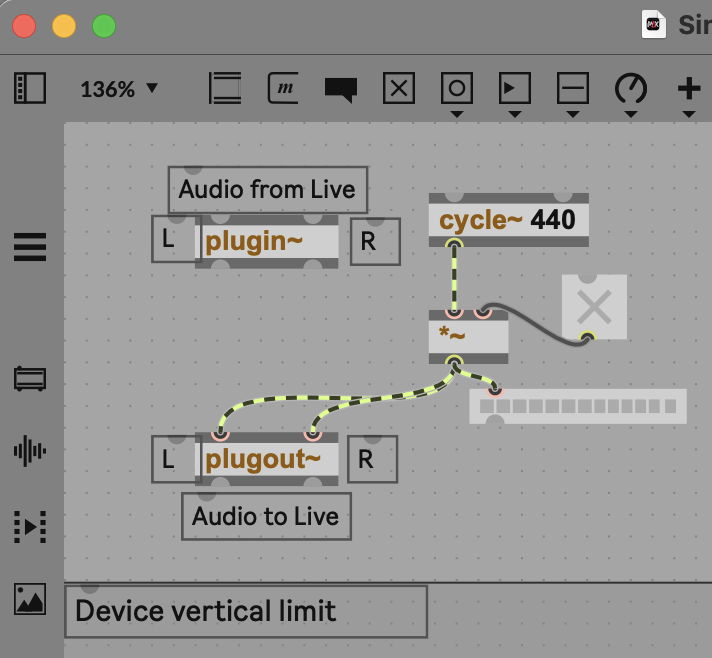
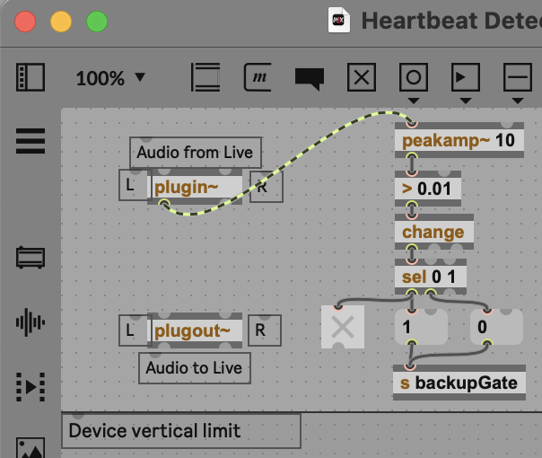
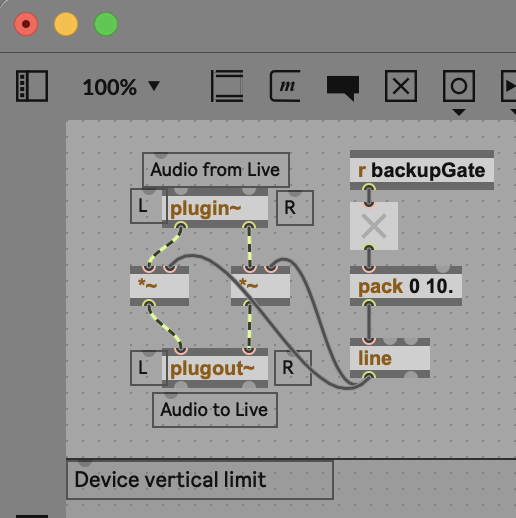

# 【ライブ同期・マニピュレーター】2台のPCを同期して再生する (Ableton Live)

ライブの同期をする際に「もしパソコンが止まったらどうしよう」というリスクを下げるために2台のPCを使うという手法があります。  
  
今回は Ableton Liveを使って2台のPCを同期して再生する方法をご紹介します!
  
### 必要機材  
  
#### PC 2台  
  
#### Ableton Live (DAW)  
今回の方法はMax for Liveを使用するので、SuiteかStandard + Max for Liveが必要です。  
  
#### オーディオインターフェース (6ch Outと4ch Outを1台づつ)  
Focusrite 16i16 4th Gen (6ch)  
MOTU M4 (4ch) など  
  
MIDI入力を使用するのでどちらかのインターフェースはMIDI入力がついているものを使ってください。
  
#### Novation Launch Control 3  
USB接続でMIDIを送りつつ、MIDI Out端子からもMIDIを送れて、  
2台のPCにMIDI信号を送れます。  

#### YAMAHA MG10

  
### 機材のセッティング  
  
#### メインPC  
Focusrite 16i16 4th Genを使います。  
  
アナログアウトは4chしかありませんが、ヘッドフォンアウトに別系統を割り当てられるため、5,6 chとして使います。  
  
#### サブPC  
MOTU M4を使います。  
  
メインPCのFocusrite 16i16 4th GenのヘッドフォンアウトからMOTU M4のInput 1に接続してください。

  
#### Launch Control 3  
メインPCにUSB接続して、MOTU M4(サブPC)にLaunch Control 3 5pin MIDI Out -> MOTU M4 MIDI inにMIDケーブルで接続します。  
  
下に8つあるボタンのうち1つのボタンを再生ボタンとして使います。  
※ Novation Component(Webアプリ)でボタンの設定のBeheiviourという項目をToggleではなくMomentaryに設定してください。

  
### Ableton Liveのセッティング  
  
  
#### Launch Control 3を使うための設定
Ableton Liveの設定からMIDIの設定でLaunch Control 3のInputのリモートにチェックマークをいれて有効にしてください。  
  
サブPCではMOTU M4のMIDI inのリモートを有効にしてください。  
  
#### Max for Live デバイスを作成する  
  
3つのデバイスを作成します。  
  
**Sine Generator.amxd** (メインPC用) 
※ デバイス作成時にサイン波の音が大音量で出てしまうため、PCやオーディオインターフェースの音量を音量ゼロ(-∞ db) にしてください。

メインPCが動いている間、サイン波をずっと鳴らし続けるためのデバイス

**Life Detector.amxd**  (サブPC用)  

サブPCでメインPCからのサイン波が動いているか・止まっているかを検知するデバイス

**Master Ducking.amxd**  (サブPC用)  
 
メインPCが動いている間、サブPCからの音を出さないようにするデバイス

#### 必要なトラックの作成  
  
**メインPC**  
Life（Sine Generator）というトラックを作成して、Sine Generatorデバイスをインサートします。

トラックのアウトプットの設定をExt.にして、5chに設定します。

Focusrite Control 2でヘッドフォンアウトのルーティングを5ch,6chを使うように設定します。
  
**サブPC**  
Life Detectorというトラックを作成して、Life Detectorデバイスをインサートします。 
※ サイン波の音が大音量ででてしまうため、Life Detectorでバイスを入れてからトラックのインプットの設定をしてください。念の為トラックをミュートにしておきましょう。

トラックのインプットを1chに設定して、\[in\]と書いてあるボタンを押してインプットモニタリングをオンにします。

  
Master Duckingデバイスをマスタートラックにインサートします。  
  
#### 再生をLaunch Control 3で出来るように割り当てする  
  
Command(Win: Control) + M でMIDIの割り当てモードになります。  
  
上部のトランスポートの再生ボタンをクリックして、割り当てたいLaunch Control 3のボタンを押すと割り当てがされます。  
（停止ボタンも割り当てましょう!）  
  
もう一度Command(Win: Control) + Mを押すことでMIDIの割り当てモードを終了できます。  
  
  
### この同期の仕組みについて
  
メインPCが動いている間はサイン波を送り、サブPCに生存していることを伝えています。  
メインPCがトラブルで落ちてしまった際はサイン波が止まります。  
  
サブPCはサイン波が止まったことを検知すると音が出るようになります。

2台のPC間でシンクのための信号を使ってのシンクはしておらず、MIDIコントローラで同時に同じタイミングでスタートすることで同期しています。

ちょっとずれてしまってもAbleton LiveのテンポのNudge機能を使うことで、自然にタイミングを合わせることができます。
